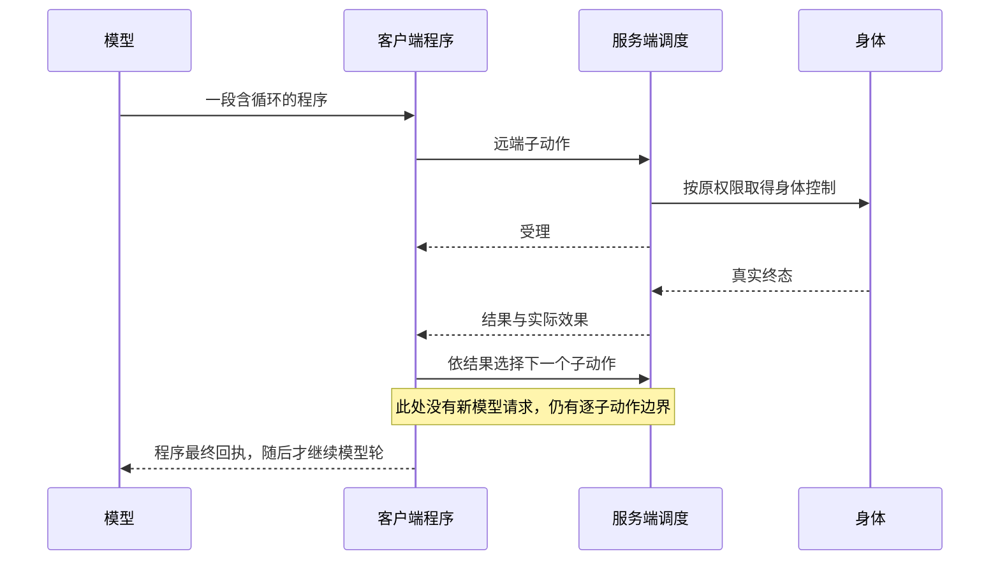

# 本体与参考项目的结构及性能对照

日期：2026-10-23，Asia/Shanghai。源码基线：`6a46872a75de149044252f346df6cee6ecf02db4`。
参考对象为开发环境中的只读副本 `minecraft-numen-1.21.1`，路径不入仓。
本文独立描述机制，不移植参考实现、提示词、技能或脚本；参考源码定位和指纹见文末。

## 1. 结论与证据边界

用户提出的三个症状需要分开处理：工具派发前等待、动作之间停顿、路线内部走停。
目前证据支持以下判断：

1. **历史日志中，长等待主要发生在模型生成可执行参数之前。**
   这不等于已经证明当前模型、当前包或参考项目的速度差；缺少同条件双边实测。
2. **当前连续执行仍有较细的客户端/服务端边界。**
   已有 Lua、gather、持续跟随和服务端局部施工，不能再说本体每挖一格都必须问模型。
   但客户端程序中的每个远端子动作仍单独经过发送、服务端执行和终态回传。
3. **路线内部的停顿有独立的控制器依据。**
   当前仅同高、同向、无编辑的直行中间节点允许穿过；转向、高差等节点使用低速站稳条件。
   更快的模型不能直接消除这类节点制动。
4. **“边工作边思考”在参考中有条件成立，不能理解为始终预测下一阶段。**
   它能让已派出的身体任务继续，同时因主人消息或急件结束程序等待、开启新的模型处理；
   还会在走当前路线时异步搜索后续路线。普通程序调用本身仍串行等待真实结果。
5. **应该学习执行粒度、事件解耦和连续导航，保留我们的身份、权限与累计账。**
   将模型和密钥全部搬到服务端、全面重写 Lua、扩大预算，都不是本次证据直接支持的结论。

证据分为四层，后文不混用：

| 层次 | 本次已有 | 能说明什么 | 不能说明什么 |
| --- | --- | --- | --- |
| 当前源码 | 双边模型入口、程序调度、身体任务、导航控制、上下文与保存链 | 执行位置、依赖和串并行契约 | 原生世界实际吞吐量 |
| 当前离线探针 | 真实生产序列化、AgentLoop、PathSteering、GoalJournal | 请求体积、明确等待条件、本机局部开销 | 模型端推理时间、原生运动速度 |
| 历史实机 | 仓内 2026-10-16 日志复核 | 当时请求和工具执行的等待分布 | 当前 31 工具版本或参考版本的同比 |
| 同条件 A/B | 尚未执行 | 未来用于量化收益与代价 | 本文不提供虚构倍数 |

本轮未读取玩家密钥/配置，未发模型请求，未启动游戏/服务器，未安装包或修改宿主、
连接器、参考和实例。未改变生产行为；K1/P1仍未实施，卡数不变。

## 2. 结构差异与连续执行

| 层次 | 当前 mcbot | 当前参考副本 | 对体验的影响 |
| --- | --- | --- | --- |
| 模型入口 | 客户端 AgentRunner/AgentLoop | 当前 CompanionBrains/CompanionLoop 在服务端组装模型循环 | 参考文档或注释中的旧客户端描述不能覆盖当前接线 |
| 模型动作接口 | 31 个常驻工具参数 Schema；短说明 + tool_help | 注册 4 个核心模型工具；世界能力主要通过程序 API；插件/MCP 可另加工具 | 参考减少顶层选择面，但 API 学习成本仍存在 |
| 技能 | 顶层 Markdown 正文全部进入提示，前缀有缓存 | 技能索引常驻，正文及支持材料按需读取 | 可能减少无关输入；也可能增加帮助/发现轮次 |
| 连续程序 | 客户端虚拟线程运行 Lua，每次远端调用等待终态 | 服务端持有程序，本地世界 API 进入主线程调度队列 | 参考减少逐原子网络往返，仍按线程规则访问世界 |
| 采集 | 客户端 gather 组合扫描、换位、单挖与新鲜状态 | 一件身体工作可持有一组目标，在内部继续选点、挖掘与处理掉落 | “程序能循环”与“身体工作自身能连续”是不同层次 |
| 施工 | build_nearby 已在服务端执行最多 12 个真实动作 | 同样具有程序组合与身体工作层 | 本体已有可复用的服务端批次先例 |
| 普通调用等待 | 真实终态打开下一工具与下一模型轮的门 | SerialCalls 等程序真实结算，再继续普通轮次 | 双方都不能把受理冒充完成 |
| 消息与工作 | 当前任务 PARK，进度事件用于界面/桥，不自动启动该任务下一模型轮 | 等身体工作时可因新消息/急件结束程序等待，身体工作仍存在 | 参考能在特定工作期间处理新的思考/对话 |
| 路线接续 | 主线程切片搜索，半程段末停止并交回上层 | 世界线程快照 + 后台搜索；当前段执行时准备接续段 | 导航连续性独立于模型是否工作 |
| 动量 | 仅严格平直节点放行；其他节点靠近并减速站稳 | 根据连续步型、身体和地面条件评估穿越、制动和疾跑 | 转弯/坡地更可能呈现不同节奏 |
| 目标验收 | 原目标基线/阶段/真实世界条件，确定性验收 | 另有目标协调和模型评估路径 | 参考额外评估也有请求成本，不宜照搬 |

当前典型客户端程序链：



源码入口：
[AgentRunner](../src/client/java/com/neko/mcbot/agent/AgentRunner.java)
的 `executeProgramChild`、`executeCompositionRemote`、`executeRemote`；
[BoundedProgram](../agent-core/src/main/java/com/neko/mcbot/agentcore/script/BoundedProgram.java)
的 `start`/`call`；
[BoundedGather](../src/client/java/com/neko/mcbot/agent/BoundedGather.java)
的 `observe`/`mine`/`continueBatch`。

gather 目前同站位最多复用 8 个目标候选，降低重复搜索，但成功移除后仍调用新鲜 status，
不能把候选复用写成服务端多块挖掘。共享 MiningWork 是工作几何，不等于持有整组目标的身体任务。
参考 DigCompanionTask 的连续性还来自组内选目标、选择覆盖更多目标的站位，以及局部任务自驱动。
这是减少需要模型介入的决策次数，而不是模型每挖一格都算得特别快。

参考程序通过 MainQueue 的独立队列和轮转在世界线程执行调用。其每刻全局 10ms、
每程序 5ms 的帽在调用间检查，不能抢断一个已开始的慢调用。脚本并非整段占住主线程。
客户端专属函数仍要反向请求客户端，所以“服务端程序没有任何网络调用”也不成立。
我们可以先评估一个有界的共用工作集，复用原挖放/控制/事实/取消链；不必先搬迁整个模型循环。
密钥仍只保留在所属玩家客户端。

## 3. “边工作边思考”具体是什么

需要区分四种时间重叠：

| 重叠类型 | 参考 | 当前本体 |
| --- | --- | --- |
| 同轮首工具与模型流尾重叠 | 有相关执行机制 | 已有 index 0 早派发；不能当成下一轮预测 |
| 本地循环持续做事 | 程序与多目标身体工作 | 已有 Lua/gather/局部施工；原子边界不同 |
| 身体工作与新的模型事件处理重叠 | 主人消息/急件可解除程序等待，已派工作继续 | PARK 不会自动开启该任务下一模型轮 |
| 走当前段与搜索后续段重叠 | Driver/Continuation/Searches | 当前 PathTask 没有这一后台接续链 |

参考 `Program` 的 `awaiting` 持有正在等待的身体工作。`urgent()`（约 282 行）在等待期间
结束当前程序，保留已经运行的身体工作；`SerialCalls.arrived()` 把适用的事件送到该路径。
随后模型可处理新输入。身体工作结束时，`taskFinished()`（约 165 行）根据程序是否仍在等待，
交给原等待方或转交事件，避免丢失收尾。

这表示身体工作的生命周期可以长于一次程序/模型轮。它不表示旧 Lua 会在后台继续跑完所有后续语句，
也不保证之后的新动作不必等待或仲裁身体。

普通参考程序仍通过 SerialCalls 串行结算；没有消息或急件时，不会仅因为身体已受理就自动启动
下一次模型规划。`GoalSteward.steer()` 明确跳过正在进行的有限身体任务，
不能把目标协调器描述成持续提前思考下一阶段的证据。

本体 [AgentLoop](../agent-core/src/main/java/com/neko/mcbot/agentcore/loop/AgentLoop.java)
的 `runTools`（约 1273 行）逐项等待 `terminalGates`；
`afterTools`（约 1240 行）仅在回执齐全后调用下一次 `step()`。
`Ledger.accepted` 记录受理而不生成虚假的完成回执。AgentRunner 的进度事件继续更新界面与桥，
这条路径没有启动新的模型请求。

离线探针让真实 AgentLoop 接到“长工作 + 后续只读工具”，结果：

```text
after_ack      model_calls=1 tool_calls=1 busy=true
after_terminal model_calls=2 tool_calls=2 busy=false
```

因此，受理后连同一轮的下一项只读工具也在等。这是当前的依赖契约，不是线程死锁；
改动它必须明确哪些结果可独立获得，以及如何保持工具回执配对。

建议分两步设计，分别验收：

1. **工作期间可回答新消息。** 身体工作以独立 handle 保留，进度/终态只结算一次；
   对话可以读新鲜状态，身体写操作仍由原唯一控制器仲裁。取消必须能取消原工作及依赖它的计划。
2. **必要时有限提前规划。** 仅允许无世界副作用的读取/计划，绑定原 task/goal 修订、
   身体/世界身份、观测版本与真实库存。工作收尾时重新核对再提交；不符合就丢弃。
   尚未入包的掉落、尚未完成的合成不能提前记为材料。推测请求也计入原模型/阶段总账。

第二步是拟议能力，不是已经发现参考在所有任务上自动这样做。
只有结果不依赖时，串行的“执行时间 + 规划时间”才可能接近重叠后的“两者较大值”；
若需要动作结果才能决定下一步，提前规划可能无效并多付请求费用。

## 4. 路线内部为何走停

[PathTask](../src/main/java/com/neko/mcbot/path/PathTask.java) 的 `executeTick`
在约 952 行计算 `through = canPassStraight()`。约 970 行的放行条件同时要求：
连续步均为普通行走、没有挖放、没有跳跃、脚高相同、水平步向完全相同。
所以平直路线的中间节点已经可以连续通过，不能概括成所有格子都停。

[PathSteering](../src/main/java/com/neko/mcbot/path/PathSteering.java) 有两种到达条件：

| 条件 | 中心水平距离 | 脚高误差 | 水平速度 |
| --- | --- | --- | --- |
| 停稳 | 不超过 0.16 | 不超过 0.08 | 不超过 0.04 |
| 放行穿越 | 不超过 0.30 | 不超过 0.08 | 不要求低速 |

两种条件都要求接地。未放行时输入带速度制动，转弯、高差等节点会先降低速度再交接下一步。
`stopMovement()` 会释放输入并清空 steering，不存在这里遗漏清空旧转向器的证据。
每刻输入失效是防止失控的约束，不应直接删除；身体原生物理仍持续执行。

离线探针给两种控制器同一“位于节点中心、水平速度 0.2”的状态：
停稳到达为 false，穿越到达为 true。它验证门槛差异，不模拟原生 travel，不提供每格实际停顿秒数。

参考 Driver/Gait/StrideControl 按连续窗口评估动量与步型，允许满足几何/地面/摩擦条件的部分转弯、
上落坡连续通过。不能简化成所有拐弯都不刹车，或关闭碰撞/精确到达。
终点、工作接触点和不安全步型仍应使用相应停止条件。

另一个差异是段间接续：

- 当前搜索在服务端主线程分片推进，每刻最多 300 节点/6ms；原节点帽 8000、累计搜索 400ms，
  另有 32768 已创建状态存储帽。这些是不同限制，CPU 帽不是墙钟完成时限。
  `PARTIAL` 走完后停止并返回未到目标，交上层决定继续；没有边走边预搜下一段的链。
- 参考先在世界线程生成快照，再把纯搜索交给固定大小线程池；
  `Continuation` 以剩余路线估计小于 100 刻为预搜触发条件，结果符合起点才拼接。
  接续没就绪时仍可能在末尾窗口前等待，不保证永远不停。
- 参考每段 4000 节点，按距离分配总账，默认至少 10 段额度；与我们的 8000 节点帽不可直接同比。
  它换目标的预算重置策略也不能直接带入本体原累计账。
- 参考搜索池线程数有限，排队队列无界；快照生成仍占世界线程。多同伴时存在快照内存、
  排队和过时结果成本，异步不等于无代价。

最有针对性的导航实验是“无模型的平直、转弯、高差、半程段”四组。
先确认停顿发生在节点制动还是段间搜索，再分别验收连续窗口和不可变快照预搜；
保留工作接触、最终站稳、预算、取消、世界变化与身体身份检查。

## 5. 模型慢：接口、输入与配置

### 5.1 当前真实请求体积

`tools/FrameworkPerfProbe.java` 使用生产 ToolCatalog、PromptBuilder 和 OpenAiCompatProvider。
固定一条合成用户输入，空人设、无技能、无历史、无实时观测；模型名用探针固定值。
以下是 UTF-8 JSON 字节，**不是 token 数或实际玩家完整请求**：

| 项目 | 字节 |
| --- | ---: |
| 空系统提示、无工具请求 | 134 |
| 基础系统提示正文 | 4730 |
| 基础系统提示请求，无工具 | 4937 |
| 31 工具请求，无系统提示 | 37832 |
| 基础提示 + 当前短说明的 31 工具 | 42635 |
| 基础提示 + 完整说明的相同 31 工具 | 60791 |
| tools 数组 | 37689 |
| parameters JSON 合计 | 25505 |
| description JSON 合计 | 9673 |

build_record/build_site/set_goal/build_nearby/build_diff 五个工具合计 18479 字节，
其中参数 Schema 合计 16221 字节。工具短说明已经有效减重，但目标结构的重复定义仍常驻。
减少说明不能同时消除参数 Schema 的成本。

合成技能正文分别为 0/4096/16384 个 ASCII 字节时，完整请求分别为
42635/46751/59039 字节。这只显示全量正文如何进入输入，没有测玩家安装了几份技能，
更没有证明技能正文是当前现场的最大开销。前缀加载有缓存，也不能误写成每轮重新读文件。

参考把常驻能力表达为模型工具、技能索引和 API 分组索引；
正文/函数帮助按需获取。不过当前可见的模型工具仍全部传给 provider，并非所有能力都先搜索再发现。
额外 MCP 和玩家模块会增加输入。本轮没有构造参考完整运行环境测量其完整请求字节，
不能用“四个核心工具”计算虚假的请求缩减比例。

### 5.2 本地快，不代表远端一定快

生产请求构造及序列化预热 30 次后采样 150 次：
均值 0.951ms，p50 0.771ms，p95 1.837ms，最大 4.787ms。
本机这段 CPU 工作不足以解释历史十秒量级的等待。
工具规模可能影响远端输入处理、选择和生成，但收益需通过同模型实测，
不能按 JSON 字节比例换算提速倍数。

当前 OpenAiCompatProvider 发送 model、messages、stream/usage 和 tools；
没有思考档位、输出长度和温度的可配置请求字段。
因此真实行为取决于端点/模型默认值；不能断言当前默认必然开高强度思考。
参考 RequestOptions/ThinkingPlan 根据兼容能力映射档位，也支持受条件约束的温度/长度；
默认 AUTO 路径并不强制发送思考字段。

后续若补模型控制，应采用能力声明、实际出站字段验证和不支持时的明确行为，
不能向全部兼容端点硬塞一种 `reasoning_effort` 参数。
双方真实选用的模型、档位、网络和中转服务未知，本文不推测谁用了更快的模型。

### 5.3 历史证据能定位到哪

来源：[2026-10-16 实机日志复核](real-game-log-review-2026-10-16.md)，第四次与第三次测试节。
这些是旧包和当时配置，早于本次 31 工具基线：

| 样本 | 结果 | 可支持的判断 |
| --- | --- | --- |
| 第四次 105 请求中 86 次完成且有派发 | first_dispatch 均值 9994ms，中位 6113ms，最大 71616ms | 当时主要长等待在可执行工具派发前 |
| 同场 40 次 craft | 合计 114ms，最大 20ms | 当时合成执行不是数十秒等待主因 |
| 第三次 31 次完成且有派发 | first_dispatch 合计 324044ms，均值 10453ms，中位 7884ms | 另一个历史样本也有类似等待 |
| 第三次 request38 | 头部 4818ms，2447 个 reasoning 字段帧，180127ms 总时限终止，无文本/工具 | 传输有字节不等于工具已就绪；不能拆出纯模型计算或中转时间 |

不把不同场次混合求总体均值；不展示或猜测 reasoning 内容；
不把旧 23/24 工具体积、旧上下文大小当作当前探针结果。

## 6. 其他会叠加的开销

### 6.1 观测、输出投影与整理

本体的程序能使用真实结构化 data，模型主要读有界 feedback；
查询大表留在程序内不等于每份查询 data 都进模型上下文。
Conversation 保留动作/失败，冻结出站投影，并在请求边界按历史软水位或完整窗口压力整理。
整理需要一次模型请求并阻塞下一轮，因此要单列次数、耗时与净节省，不能只盯普通请求延迟。
新鲜观测是当次输入，不应一律当作持续累积历史。

当前 AgentRunner.requestObservation 在 journal 存在时，对普通短任务也请求 recovery=true。
StatusTool 因此构造恢复空间数据，SpatialCheckpoint 最大 16000 UTF-8 字节；
ToolOutcome 的 data 构造/访问还涉及深拷贝。这是潜在服务端快照、线上传输和分配成本。
**recovery_spatial 不被直接塞入模型提示**：AgentLoop 的观测注入读取 feedback，
所以不能据此宣称每轮提示多了 16KB。实际尺寸、分配和构造耗时尚未测量。

K1 可优先测“技能索引/正文按需 + 常驻输入经济性”，同时保留短任务低发现成本。
缓存要覆盖稳定提示和工具定义，但不能缓存过时现场，也不能把只读空查询当成新的进展。

### 6.2 恢复日志的同步落盘

GoalJournal.block 是同步、带范围目录检查和 force(true) 的持久在途标记；
save 先 block，再持久写入和替换。长期目标的 loop、runner 和变更派发边界可能重复进入
blockSavedGoal。它维护崩溃后不重放未知动作的保证，不能为提速直接删掉。

真实 GoalJournal、合成 16KiB 数据、本机文件系统，各 40 次采样：

| 操作 | 均值 ms | p50 ms | p95 ms | 最大 ms |
| --- | ---: | ---: | ---: | ---: |
| 一个范围反复 block | 1.563 | 1.502 | 2.127 | 2.225 |
| 16KiB 合成 ready 保存 | 3.666 | 3.443 | 4.438 | 6.730 |
| 128 范围下反复 block | 2.013 | 1.857 | 2.660 | 3.310 |

不是磁盘普遍性能保证；没有测真实玩家历史数据、杀毒、并发或慢盘。
本次量级同样不足以单独解释历史十秒模型等待，但同步链上多次调用可能增加动作交接开销。
可评估在同一在途代际内合并已经持久的标记，或有序 IO 队列；
任何副作用仍必须等待对应持久保证，保存失败仍拒发，不能异步“先做再补”。

### 6.3 感知与预算差异

本体 FindResourceTool 明确限制 4096 采样、16 返回目标、24 工作候选、2048 射线预算；
分页/未知和换区也受累计账约束。参考的地形视图、扫描及目标分组减少了模型逐坐标试探，
LookAround 的近场表达还沿导航几何生成。这里值得学的是共享几何和面向工作的表示，
不是移植符号表或宣称参考有无限全图索引。

参考脚本默认 200 调用/20 分钟，本体默认 128 调用/300 秒、可配置最高 900 秒。
允许连续做事更久，与相同工作量处理更快不同。实验应同时报告成功、真实产量、
搜索/模型/动作预算消耗，不能把更大额度的完成率当成纯性能优势。

## 7. 下一轮如何量化，避免“感觉快了”

先分开测两个问题：

- **身体层**：模型完全退出路径，用等价明确目标和准备好的库存，测控制器/调度。
- **端到端**：同模型/端点/思考档位和同条件任务，测决策、学习成本与完成质量。

记录游戏/模组版本、JAR 哈希、配置摘要（不含密钥）、世界种子及恢复的初始快照、
身体属性/装备/饥饿、区块加载、权限、服务器 TPS、客户端帧率和网络。
参考是 1.21.1，本体是 1.21.11，原版物理与 API 版本是比较混杂因素，必须保留在结果中。
先冷启动与热缓存分组，各场景至少 5 个完整样本，交替运行顺序。
报告中位与尾部、全部失败/取消及请求费用，不挑成功最快一次。
双边不支持同能力的场景单列能力覆盖，不能算慢或强行降低成功标准。

| 场景 | 控制条件 | 主要区分的成本 |
| --- | --- | --- |
| 新任务只读状态 | 无技能与固定技能集分别测 | 冷输入、帮助发现、首个可执行参数 |
| 材料/工位就绪的合成 | 相同配方、库存和产量 | 模型选工具与毫秒级本地执行 |
| 平地直线 32 格 | 无挖放、同速度属性 | 起步、直行穿越、终点制动 |
| 转弯走廊/连续台阶 | 固定安全地形 | 每节点减速与路线窗口 |
| 超出单段的安全路线 | 固定总预算并记录差异 | 搜索、等待接续、半程重发 |
| 同站位可达 8/32 目标 | 同工具耐久、硬度与掉落规则 | 组内连续工作、单动作回传 |
| 多站位采集与自然拾取 | 同净新增目标 | 换位、重新观测、掉落结算 |
| 超过 16 格的建筑目标 | 双方支持的材料/形状交集 | 批次边界、目标保护与全目标验收 |
| 长工作中询问状态 | 问询时不取消、不改原目标 | 身体继续、模型响应、最终收尾归属 |
| 多阶段目标及显式恢复 | 相同总账和真实最终条件 | 上下文整理、阶段切换、持久化和恢复开销 |

身体层指标至少包括路线墙钟、真实移动距离、到达误差、每节点低速/空输入刻数、
搜索 CPU/墙钟/排队/快照时间、主线程最长切片及 TPS 影响。
空输入也可能是必要的开采/落地/等待，要按活动阶段标注；不能把所有静止都算浪费。

端到端新增或汇总以下时间点，统一单调时钟并带原 task/body/job/call 标识：

| 链路 | 时间点/量 |
| --- | --- |
| 模型 | 请求开始、响应头、首字节、首文本、首工具参数完整、实际派发、流结束、usage/缓存/错误 |
| 远端动作 | 客户端排队/发送、服务端接收/排队、受理、身体开工、终态、客户端接收、下一子动作发送 |
| 本地程序 | 运行/挂起、原子调用数、程序错误、帮助调用、重扫次数、真正需要的新模型轮 |
| 导航 | 节点制动、环境暂停、工作接触、段间搜索等待、重规划及失败的原因 |
| 上下文/保存 | 固定输入/历史/观测体积、整理耗时/净节省、快照构造与拷贝、持久化耗时 |

已有 first_dispatch/流看门狗/路径诊断继续复用，缺口再补。不得记录 API key、
Authorization、桥 token 或模型内部 reasoning 正文。
总耗时按时间轴计算关键路径；重叠的流尾、动作和搜索不能重复相加。
重点看“身体可继续但无人驱动”的间隙，以及这些间隙占总时长的比例。
真实完成条件、材料/数量守恒、权限/取消/死亡隔离是硬门：更快但漏动作、少交付、
误报完成或无法停手都不算改善。

## 8. 建议优先级与不变的框架契约

这是本次审计建议，不自动改写当前排期或宣称优化已实现：

1. **先补能归因的时间轴，再做当前 K1。**
   复用现有日志，测稳定输入、正文读取、帮助轮次、token 与请求费用。
   按需能力以总请求成本和任务成功率验收，不能只验收首包缩小。
2. **P1 候选先针对导航连续性。**
   分别处理安全节点穿越和段间预搜，用无模型场景证明差异；
   新快照/后台队列也要有内存、排队、取消与过时结果约束。
3. **测量后推进共用服务端工作集。**
   优先减少已经明确重复的“单挖—终态—status—下一单挖”边界，
   沿已有动作核内部持续推进，并保留真实效果与有界进度；不为矿种或成品写专用链。
4. **独立评审工作与对话的生命周期。**
   先让长工作中响应新消息，再根据证据决定是否加入有限只读提前规划。
   不从终态门上简单删一个等待，也不让两个写动作争抢身体。
5. **提供兼容能力驱动的模型控制。**
   思考档位和输出预算需可验证、可比较；不猜默认参数，不为追求响应而假定所有任务可关思考。

所有候选都必须共用长短任务入口、原目标与真实最终验收、权限与身体唯一控制权、
实际掉落/库存事实、取消/死亡/换世界隔离，以及原模型/阶段/搜索/动作累计账。
后台计划、换路线、拆程序、断线恢复不能刷新预算或恢复旧批准。
允许停下重新观测未知现场；不靠扩大臂长、传送、跳过原版动作或降低验收获得速度。

## 9. 离线探针复现与构建边界

先按 `DEVELOPMENT.md` 配好 JDK 21，运行仓内 `gradlew build --offline --console=plain --no-daemon`。
然后用 Java 源文件启动模式运行 `tools/FrameworkPerfProbe.java`，classpath 包含：

```text
build/classes/java/client
build/classes/java/main
agent-core/build/classes/java/main
<构建缓存中的 gson-2.11.0.jar>
```

等价命令（按本机替换占位符；Windows classpath 分隔符为 `;`，其他系统为 `:`）：

```text
<JDK21>/bin/java -Dfile.encoding=UTF-8 --class-path <上述classpath> tools/FrameworkPerfProbe.java
```

探针不接受参数，不构造网络客户端、不读玩家配置；provider 只生成内存 JSON。
GoalJournal 使用忽略目录 build 内新建的独立临时子目录，最后删除本次夹具。
使用真实 AgentLoop/PathSteering/GoalJournal 的契约断言，但不模拟原生物理或模型服务。
本地计时不是 JMH 或隔离磁盘基准，需保留样本量、预热和机器差异限制。

本次输出证据为本地忽略文件 `build/framework-perf-probe-20261023.log`；
量化结果已摘录在本文，不要求协作者拥有同一机器的日志。
清理未用 import 后另存 `build/framework-perf-probe-final-20261023.log`，复跑体积及契约一致，
序列化均值 0.901ms/p95 1.669ms；本文保留首次计时，不用复跑较快值覆盖它。
构建、测试/XML及提交状态统一记在 STATUS，本探针不计入 Gradle 的 JUnit 用例数量。

## 10. 源码定位与只读副本指纹

本体可从以下入口复核，行号以文首提交为准：

| 主题 | 本体入口 |
| --- | --- |
| 模型工具与短说明 | `src/client/java/com/neko/mcbot/agent/{ClientToolDefs,ToolCatalog}.java` |
| 技能/提示 | `agent-core/src/main/java/com/neko/mcbot/agentcore/prompt/{PromptBuilder,SkillLoader}.java` |
| 模型请求体 | `agent-core/src/main/java/com/neko/mcbot/agentcore/provider/OpenAiCompatProvider.java:72` |
| PARK、回执序列 | `agent-core/src/main/java/com/neko/mcbot/agentcore/loop/AgentLoop.java:1240`，`:1273` |
| 原子远端链 | `src/client/java/com/neko/mcbot/agent/AgentRunner.java:1552`，`:1587`，`:1607` |
| 每次观测的恢复数据 | `src/client/java/com/neko/mcbot/agent/AgentRunner.java:1284`；`src/main/java/com/neko/mcbot/server/tools/StatusTool.java:66` |
| 路线搜索/穿越 | `src/main/java/com/neko/mcbot/path/PathTask.java:340`，`:952`，`:970`；同包 `PathSteering.java` |
| 持久在途标记 | `agent-core/src/main/java/com/neko/mcbot/agentcore/loop/GoalJournal.java:43`，`:64` |
| 感知预算 | `src/main/java/com/neko/mcbot/server/tools/FindResourceTool.java:27` |

参考路径均相对只读副本根，不是本仓文件：

| 主题 | 参考入口 |
| --- | --- |
| 当前模型循环所在位置 | `numen-api/common/src/main/java/com/dwinovo/numen/api/brain/{CompanionBrains,CompanionLoop,LlmMind}.java` |
| 常驻工具/提示/正文 | `numen-api/common/src/main/java/com/dwinovo/numen/api/CommonClass.java:59`；`agent/request/{SystemPromptComposer,AgentRequestContext}.java`、`agent/skill/SkillRegistry.java`（后两组位于同 api 包） |
| 等待与事件解耦 | `agent/src/main/java/com/dwinovo/numen/api/agent/loop/{Program,SerialCalls,AgentLoop}.java`；`Program.java:165`，`:282` |
| 有限工作期间不催目标 | `agent/src/main/java/com/dwinovo/numen/api/agent/goal/GoalSteward.java:153` |
| 服务端程序调用调度 | `numen-api/common/src/main/java/com/dwinovo/numen/api/program/{ProgramHost,LocalPrograms,MainQueue,ProgramLimits}.java` |
| 身体任务控制 | `numen-api/common/src/main/java/com/dwinovo/numen/api/task/{TaskApi,TaskDispatch,CompanionBrain}.java` |
| 多目标采掘 | `numen/common/src/main/java/com/dwinovo/numen/task/dig/DigCompanionTask.java`；`numen/common/src/main/resources/numen/modules/numen/work.lua` |
| 接续和步态 | `numen/pathing/src/main/java/com/dwinovo/numen/pathing/drive/{Driver,Continuation,Gait,StrideControl,Allowance}.java`；`Driver.java:558`，`:711` |
| 后台搜索/快照 | `numen/pathing/src/main/java/com/dwinovo/numen/pathing/search/{Searches,WorldSnapshot}.java` |
| 模型参数 | `ai/src/main/java/com/dwinovo/numen/api/agent/provider/{RequestOptions,ThinkingPlan,OpenAIProvider}.java` |
| 近场表达 | `numen/common/src/main/java/com/dwinovo/numen/tools/perception/LookAround.java` |

只读副本没有 Git 元数据，本次不能给它标注提交。2026-10-23 读取的关键文件 SHA256
如下；只标识列出的源码，不代表副本全部文件或运行版本：

```text
63819ac946c9e0d2b917327c841bbc30d3e1547bfa1be1a5a618a759c36e17d6 numen-api/common/src/main/java/com/dwinovo/numen/api/CommonClass.java
6b957102a36ecd53e88b4a39ac37a291dd63a2fa2404fc7d068f70ef80c6c6fc numen-api/common/src/main/java/com/dwinovo/numen/api/brain/CompanionBrains.java
7fb278e595d04f415ac7868f07671585f52f6ec9e7eefa97f0ff04f8a3495d67 numen-api/common/src/main/java/com/dwinovo/numen/api/agent/request/SystemPromptComposer.java
38d66d5e802ff13faa52eafb33f7913a2a29ea19111fd9b9cf0f4c19caf0ceb9 agent/src/main/java/com/dwinovo/numen/api/agent/loop/Program.java
0012720230d9142f8edab27619cdd6caaa264fac748383c59bb480c8643ba24f agent/src/main/java/com/dwinovo/numen/api/agent/loop/SerialCalls.java
f5eeb0803c6a9ad59e1977863fc1243c54d7333f60a48f57207e2fc7b071af54 agent/src/main/java/com/dwinovo/numen/api/agent/goal/GoalSteward.java
d7b27b0b6e67f9243e6e1ad9a7f027df7c2595aca6e1be18bab503cf7b67f6f4 numen/pathing/src/main/java/com/dwinovo/numen/pathing/drive/Driver.java
a68e2e21c03720e4aa72368a141b246723d58d77041351af6430e58f0b05894e numen/pathing/src/main/java/com/dwinovo/numen/pathing/drive/Continuation.java
567ad058d3f5409573b2d84d2e213b94ed787ab230672d8b46c7352a9473dca0 numen/pathing/src/main/java/com/dwinovo/numen/pathing/drive/Gait.java
7c754b75d1a0585cbf445a93525c39c4ddfc96eaed013216446f30d318dcd123 numen/pathing/src/main/java/com/dwinovo/numen/pathing/search/Searches.java
acbef0e71973487b5060a74f6db8cff3942a9c58ca3fd09591182e4357f20a4d numen/common/src/main/java/com/dwinovo/numen/task/dig/DigCompanionTask.java
6f13d03e8d733b1b1a9a93cc39f1a9b0c2101d49838a6f232a8cedd944a598c3 ai/src/main/java/com/dwinovo/numen/api/agent/provider/ThinkingPlan.java
```
